# BarberNSK — Telegram-бот записи для барбершопа

> Бот принимает заявки на запись 24/7: клиент проходит анкету за пару минут,
> мастер получает заявку в личку с именем, услугой и временем.
> Собран на конструкторе SaleBot, без кода.

## Результат

- Клиент записывается сам, без звонков и переписок — бот работает круглосуточно
- Мастер получает заявку в личку: имя, телефон, услуга, дата и время
- Отзывы собираются через кнопку на Яндекс.Карты
- Кнопка «Подписка» ведёт на канал с акциями — база клиентов растёт

## Как это выглядит

**Старт-меню**
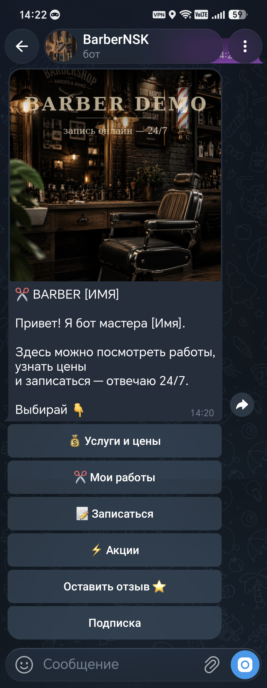

**Прайс**
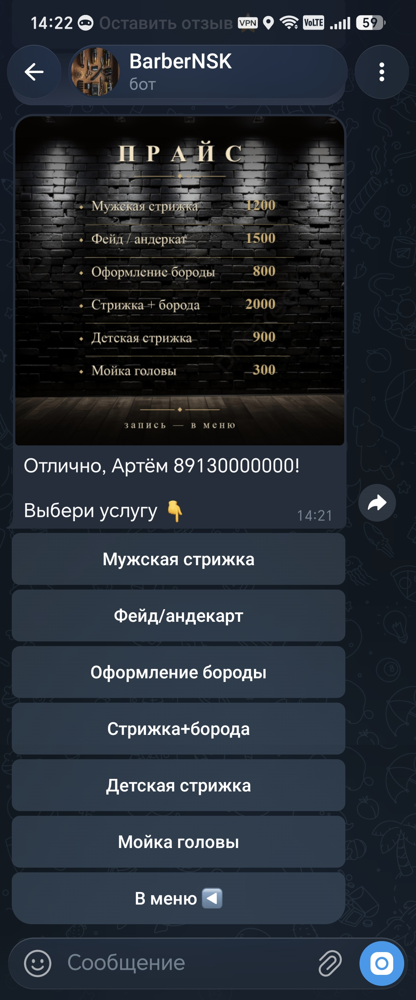

**Запись — первый шаг анкеты**
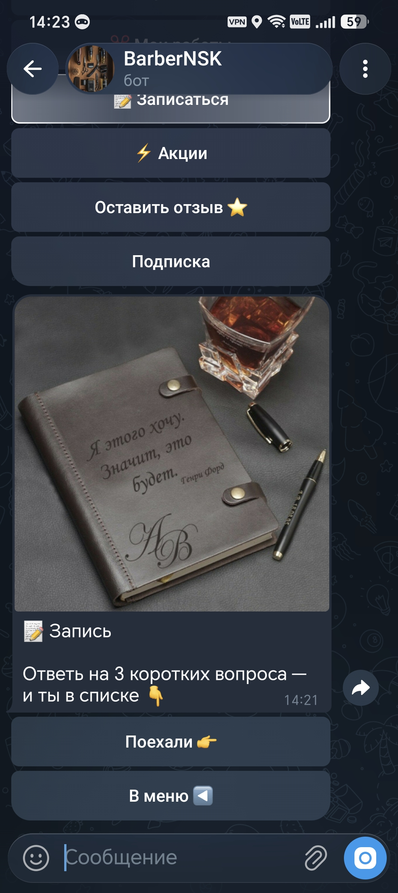

**Клиент оставляет контакты**
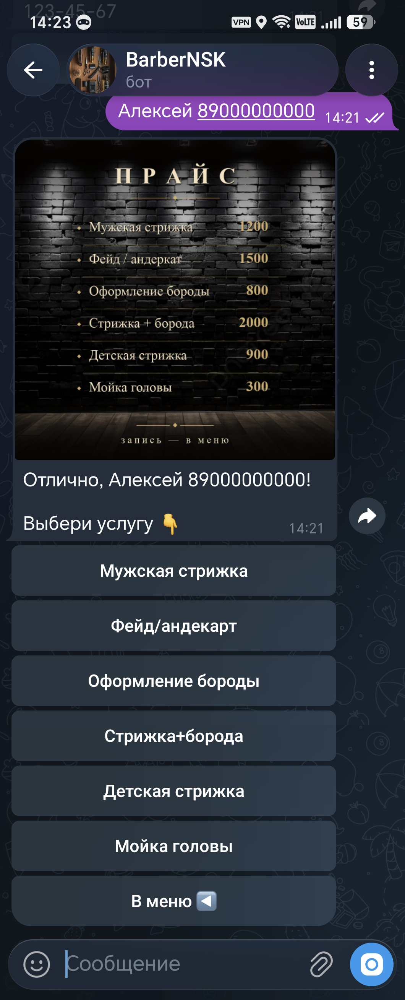

**Выбор услуги и времени**
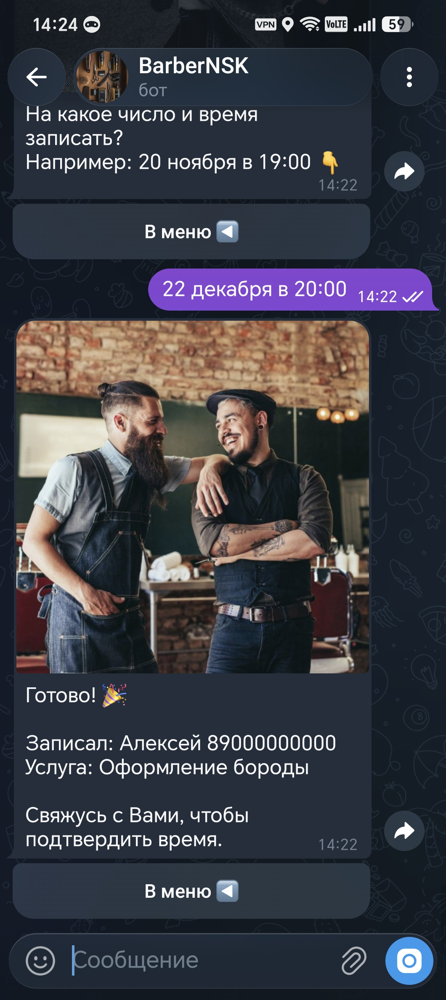

**Подтверждение записи**
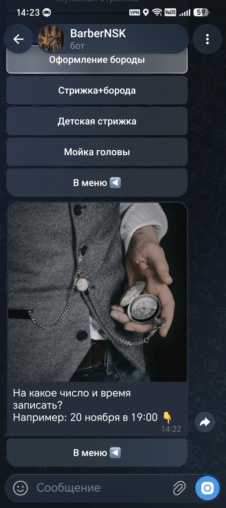

**Акции**
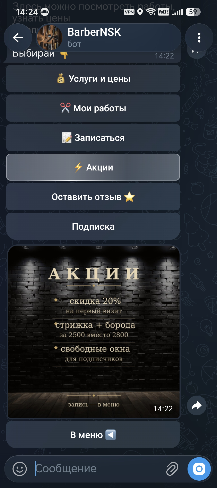

**Блок отзыва**
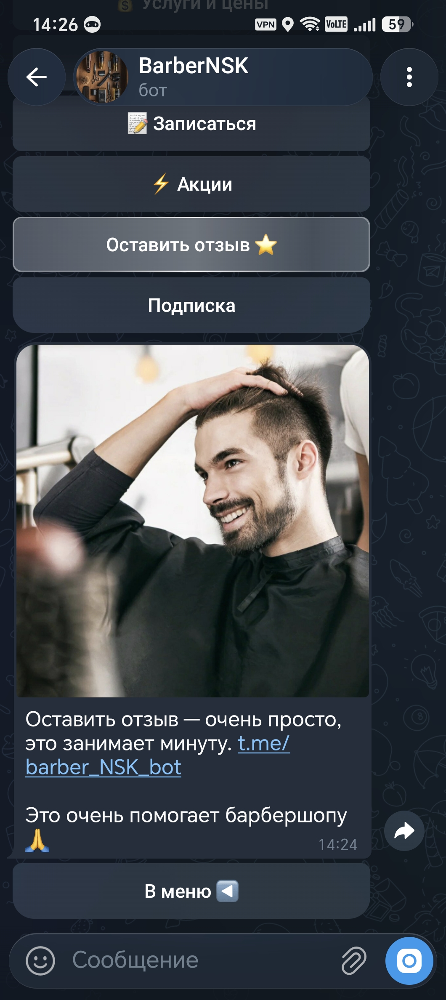

**Блок подписки**
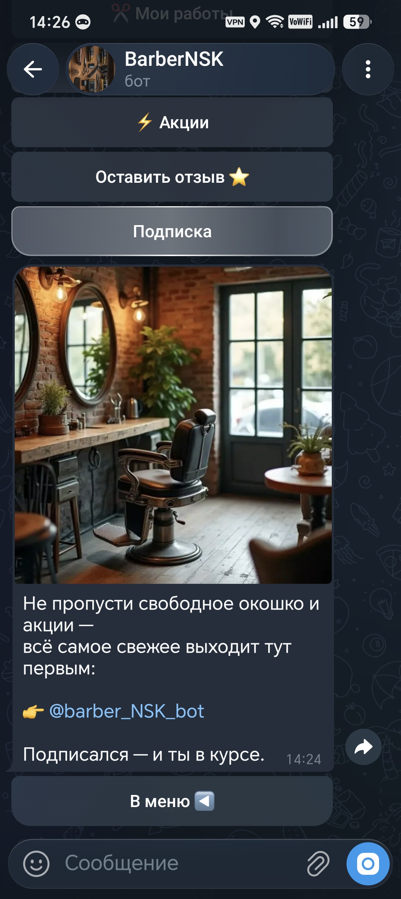

**Витрина работ**
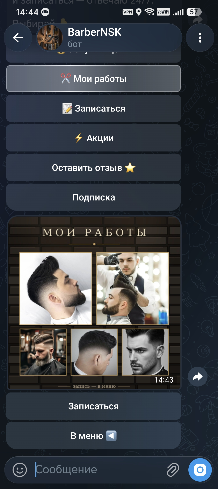

**Заявка приходит мастеру в личку**
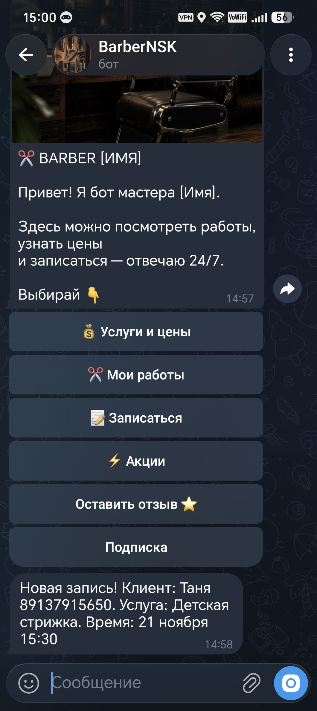

## Функционал

| Блок | Что делает |
|---|---|
| Старт-меню | 6 разделов: услуги, работы, запись, акции, отзыв, подписка |
| Прайс | Картинка с ценами, кнопки услуг, возврат «В меню» |
| Анкета | Имя и телефон сохраняются в переменную `custom_kontakt` |
| Услуга | Автозапись выбранной услуги через переменную `question` |
| Время | Свободный ввод «20 ноября в 19:00», сохраняется в `custom_vremya` |
| Готово | Подтверждение клиенту + заявка мастеру через `message(client_id, ...)` |
| Мои работы | Витрина-коллаж с кнопкой «Записаться» |
| Отзыв | Кнопка-ссылка на Яндекс.Карты |
| Подписка | Ссылка на канал с текстом-приманкой |

Из любого блока работает возврат в меню — клиент не может «потеряться».

## Технологии

- SaleBot — визуальный конструктор ботов, без кода
- Переменные: `custom_kontakt`, `custom_usluga`, `custom_vremya`
- Переменная `question` — автозапись услуги из нажатой кнопки
- Функция `message()` — мгновенная отправка заявки мастеру
- Дизайн: 10+ баннеров 1080×1080 в едином стиле

## Сроки и масштаб

- Первый бот: полный цикл — от схемы и текстов до финального теста
- Тиражируемость: аналогичный бот для маникюрного мастера собран за 7 часов
- Схема переносится на любую нишу записи (салоны, студии, мастера)

## Roadmap

- [ ] Отложенное напоминание за 24 часа до визита
- [ ] Сегментация базы: рассылка по клиентам раз в месяц
- [ ] Онлайн-оплата предоплаты

## Контакты

Telegram: @yan154rus
